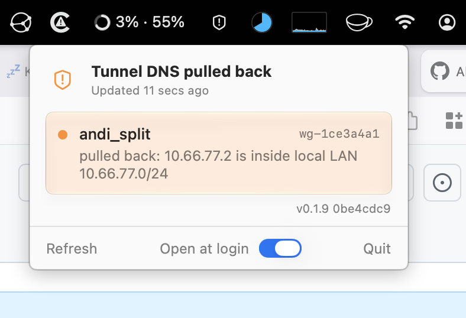

# macOS WireGuard Daemon

`wgd` is a command-line WireGuard VPN client for macOS, written in Rust,
built around a privileged, multi-connection store.



## Why

Install once, forget about it.

Its flagship use case is a split tunnel that permanently connects your
workstation to "home" (your LAN, your servers, your internal DNS) as a launchd
daemon that is simply always there and never gets in the way. Add your config
once; from then on the tunnel comes up at login, survives network roaming and
sleep/wake, and continuously reconciles routes and DNS against whatever
network you are currently on.

Because reconciliation is continuous, the tunnel needs no On-Demand or
location-based triggers. It stays up everywhere and adapts. It is meant as a
dependable alternative to `WireGuard.app` from the App Store, for people who
would rather manage the tunnel from the command line, or not manage it at all.

Underneath is a general privileged connection store: you can add any number
of WireGuard configs, each independently connected, disconnected, and set to
come up automatically or stay manual.

## Origins

This project is a fork of [CaddyGlow/tunmux](https://github.com/CaddyGlow/tunmux).
Thanks to the original author, who pursued a different goal with the project;
it serves here as the technical base.

## Install

Via Homebrew (Apple Silicon only):

```bash
brew install --cask pansen/tap/macos-wireguard-daemon
```

If you installed `wgd` before the tap switched from a Formula to a Cask, run
`brew uninstall macos-wireguard-daemon` first: the old Formula's `bin/wgd`
collides with the Cask's binary symlink and the install fails until it's gone.

This installs `wgd` on your PATH and registers the privileged launchd
daemon, prompting for your password once (via `sudo`). `brew upgrade` prompts
again on every new release, to reinstall the daemon from the upgraded binary.

The cask also installs `WgdBar.app` into `/Applications`, a menu bar icon
that shows whether the tunnel and its DNS are in effect. It is only a client
of the daemon: quitting it leaves the tunnels running. "Open at login" in its
menu is off by default.

The release DMG is signed with a Developer ID certificate, notarized, and
stapled, so Gatekeeper accepts it without a quarantine workaround. Binaries
you build from source are not signed or notarized.

From source:

```bash
make install WGD_PROFILE=/path/to/your.conf CONNECTION_NAME=home
```

This builds and installs `/usr/local/bin/wgd`, runs `wgd launchd reload` (see
below), adds your config as a per-user connection named `CONNECTION_NAME`
(`--force --start-mode automatic`), connects it, and installs bash
completion. With the Homebrew cask installed, it replaces the cask's binary
instead of installing a second copy; `brew reinstall --cask
macos-wireguard-daemon` restores the release. Re-running it after editing the
config is safe: an unmodified file is a no-op, a changed one replaces the old
record.

Access to the privileged daemon is limited to a dedicated `wgd` group, which
the install creates and adds you to (a re-login may be needed for the
membership to take effect).

Upgrading from a pre-connection-store install (the old `wgconf`/`autoconnect`
design): there is no automatic migration; run `connection add` once per
existing config.

### Shell completion

```bash
wgd completion install [--shell bash|zsh|fish]   # default: bash
```

Writes a block between `# begin: wgd managed` and `# end: wgd managed` markers
into `~/.bashrc`, `~/.zshrc` or `~/.config/fish/config.fish`. Running it again
updates the block in place, and symlinked dotfiles are kept.

### Reload and restart

A macOS update can leave the launchd services booted out or disabled. To put
both back and reconnect, run as your normal user:

```bash
wgd launchd reload     # make reload does the same
```

It re-registers the daemon (via `sudo`), disconnects your connections, and
reinstalls the session agent, which reconnects your automatic ones; `-s`
keeps only the step headers. `sudo wgd launchd restart` only restarts the
daemon and reconnects nothing.

### Uninstall

`make uninstall` (or `sudo /usr/local/bin/wgd launchd uninstall` plus `wgd
launchd agent uninstall`, then `wgd dns repair`) disconnects all tunnels and
unregisters the daemon and the session agent; stored connections, binary,
group and logs stay. `brew uninstall` does the same for the daemon.

`wgd launchd purge` also restores DNS and deletes the connection store, the
logs, the authorization right and the `wgd` group, and lists session-agent
plists other users still have. `brew uninstall --zap macos-wireguard-daemon`
and `make purge` run it and then remove the binary.

## Connections

Every WireGuard config `wgd` knows about is a **connection**: parsed and
fingerprinted at add time, then stored by the privileged daemon under an
opaque id (you can also refer to it by the name you gave it). Two kinds:

- Global connections are system-wide and root-owned; every operation on one
  requires root. If set to automatic, a global connection comes up the next
  time anything wakes the privileged daemon after a reboot (your login
  session agent, or a plain `wgd status`), not immediately at boot: the
  daemon itself is socket-activated on demand, not a boot-time service.
- Per-user connections only live inside your session and don't need `sudo`
  for their owner to use. If set to automatic, the session agent brings them
  up at login and tears them down at logout (not on fast user switching to a
  different session; that case isn't handled yet).

A per-user automatic connection needs its owner's session agent.
`connection add --start-mode automatic`, `connection mode <id> automatic`,
`connection connect`, `connection refresh` and `sudo wgd launchd install`
install it when it is missing. If you switched it off in System Settings ->
General -> Login Items, wgd only warns (`wgd status`; `wgd doctor` reports
`FAIL`); `wgd launchd agent install --force` turns it back on.

```bash
wgd connection add --file <path> [--global] [--name <label>] [--mtu <n>] [--start-mode manual|automatic] [--force]
wgd connection list [--global | --all]   # alias: ls
wgd connection get <id-or-name>
wgd connection connect <id-or-name> [--gotatun-debug]
wgd connection disconnect <id-or-name> | -a/--all
wgd connection mode <id-or-name> <manual|automatic>
wgd connection config <id-or-name> [--dns-dynamic-store | --no-dns-dynamic-store]
wgd connection refresh <id-or-name> [--file <path>]
wgd connection remove <id-or-name>
wgd launchd agent {install,status,uninstall}
```

Adding, removing, refreshing to a changed config, and switching a global
connection from manual to automatic require macOS admin authentication
(password or Touch ID): only these let new root-executed content, such as
`PreUp`/`PostUp`/`PreDown`/`PostDown` hooks, into the store or make it run
unattended at boot. Everything else only requires owning the connection (or
root for a global one), like the macOS Network pane, which asks for admin
credentials to add a VPN profile but not to connect it.

`--mtu` only applies at `add` time and is applied again on `refresh`;
changing it means re-adding (`--force` replaces a same-named record).

`refresh` re-reads the `.conf` the connection was added from (shown as
`source:` by `connection get`; symlinks are followed) and keeps id, name and
start mode. `--file` refreshes from another file, which then becomes the
source. `wgd` reads the file as you; the daemon never opens it. An unchanged
file is a no-op; a changed one asks for admin authentication and reconnects a
running connection. `refresh` refuses a config identical to another of your
connections.

## What it does while you forget about it

- Keeps each connected tunnel up across network roaming (Wi-Fi to Ethernet,
  Wi-Fi A to Wi-Fi B) and sleep/wake, without a manual reconnect.
- Continuously reconciles **routes** against the live network: tunnel routes
  that would hijack the currently active LAN are dropped, so a split tunnel
  behaves correctly whether you are at home, in the office, or tethered.
  [LAN bypass links](#lan-bypass-links) extend that to hosts behind a NAT in
  your LAN.
- Reconciles **DNS** as well as it can, so lookups for your internal names
  keep resolving through the tunnel as the network underneath changes.

### LAN bypass links

The LAN exclusion only knows the subnets your Mac is attached to. A host one
NAT layer further out, such as the upstream router at `192.168.188.1` behind
your gateway `10.66.77.1`, is not attached, so its AllowedIPs route stays on
the tunnel and the traffic leaves the house and comes back. A link tells `wgd`
that while the Mac is attached to an anchor network, some prefixes should stay
off the tunnel too:

```bash
wgd connection config <id-or-name>                                           # show the settings
wgd connection config <id-or-name> --set-link 10.66.77.0/24=192.168.188.1/32 # anchor=prefix[,prefix...]
wgd connection config <id-or-name> --add-link 10.66.77.0/24=100.64.1.0/24
wgd connection config <id-or-name> --no-links
```

`--set-link` can be repeated and replaces all earlier links. `--add-link`
adds to them instead; prefixes for an anchor that already has a link join that
link. Every network in a
link must exist in the connection's AllowedIPs as it stands, and a mistake is
rejected with a message that says which. The anchor must be an AllowedIPs
entry, which makes it the LAN the exclusion already keeps off the tunnel.
`wgd` only removes routes the tunnel owns, so a bypass prefix that is not
listed, one inside a broader entry such as `192.168.0.0/16`, and any prefix
under a `0.0.0.0/0` or `::/0` entry are rejected as well. Host bits are
cleared (`10.66.77.5/24` becomes `10.66.77.0/24`). The anchor is matched like
the LAN exclusion itself: it is active while one of your attached subnets
contains it. A bypass prefix takes every route inside it along: with
`192.168.188.0/24` bypassed, a separate `192.168.188.7/32` entry leaves the
tunnel too. Links are stored with the connection, not in the `.conf`, and
`refresh` keeps them.

A connected connection is reconnected so a change applies at once; with
`--no-apply` it applies at the next connect. When `refresh` or `add --force` brings
new AllowedIPs, the links are pruned to match: prefixes that are no longer
valid are dropped, and a link goes when its anchor is gone or no prefix is
left. The command lists what it removed. As a safety net, a link that still
fails to validate at connect is ignored, and `wgd connection get` and the log
(`connection_bypass_link_invalid`) say why. `wgd status` marks a bypassed
route as `excluded: link 10.66.77.0/24 on en0, kept off the tunnel` and warns
if the kernel sends it out through another interface than the anchor's, which
can happen with Ethernet and Wi-Fi up on different networks. If the kernel
still routes it through the tunnel because removing the route is pending or
failed, the row says so instead. Details and
limits: [doc/lan-bypass-links.md](doc/lan-bypass-links.md).

With shell completion installed, <TAB> completes the connection and then the
`--set-link` or `--add-link` value from that connection's AllowedIPs: first the anchor (written
with its `=`), then the prefixes, which are offered only while they would
validate and not twice, and further prefixes after a `,`. This works in bash
(3.2 and current), zsh and fish. bash cuts words at `=` and `:`, so wgd
registers its own bash completion function (`COMPLETE=bash wgd` prints it,
which is what the block from `wgd completion install` evaluates) that joins those pieces before asking wgd and
trims the candidates to the part bash replaces. It reads `COMP_WORDBREAKS` and
never changes it, and it does not need the bash-completion package. Shells
that sourced an earlier registration need a new shell, or a new `eval`, to get
it. The candidates come from the daemon; if it does not answer quickly,
nothing is offered. bash lists a second prefix together with the ones before
it (`192.168.188.1/32,100.64.1.0/24`) because it replaces only the text after
the `=`.

A link trusts the anchor network by its subnet alone. Another network that
uses the same subnet, such as a hotel on `192.168.1.0/24`, activates it, and
the bypassed traffic then goes unencrypted into that network. Do not use links
for prefixes whose traffic must never leave the tunnel.

### DNS

By default, `wgd` sets a tunnel's `DNS =` servers on your primary network
service with `networksetup`, re-applies them when the network changes,
pulls them back while a tunnel DNS server sits inside your current LAN, and
restores the previous setting on disconnect. A killed helper leaves them
behind; the daemon restores them when it notices or at the next boot, and
`wgd dns repair` does it on demand.

Per connection, the tunnel DNS can instead go through the macOS
SystemConfiguration dynamic store:

```bash
wgd connection config <id-or-name>                          # show the setting
wgd connection config --dns-dynamic-store <id-or-name>      # opt in
wgd connection config --no-dns-dynamic-store <id-or-name>   # back to networksetup (default)
```

`wgd` then adds its own resolver and never changes your network services'
DNS. The resolver lives only as long as the tunnel's helper, so a crash or a
reboot leaves nothing to repair. A connected connection is reconnected to
apply the change, unless `--no-apply` leaves that to the next connect. The
mode is new and so far tested on macOS 27.2 only; queries an app binds to one
interface bypass it, which matters for full tunnels. Details and open
questions: [doc/dns-dynamic-store.md](doc/dns-dynamic-store.md).

## Troubleshooting

```bash
wgd status [--dns | --json]        # connections, wg show, routes, DNS, DNS custody notes
wgd launchd status                 # daemon state, socket permissions, group, helper pids
wgd logs [-f] [-n N] [--launchd] [--all] [<connection>]
wgd doctor [--report <file>]       # status, launchd status and logs in one report
wgd dns repair                     # restore DNS a killed helper left behind (networksetup mode)
```

For each connected connection, `wgd status` shows routes, "Tunnel DNS"
(where each server is applied, plus the dynamic store key; without the
option it is a muted `shadow` probe) and "System resolver" (what macOS uses
right now). `--dns` adds every network service's DNS servers; `--json`
prints the report as JSON.

`wgd launchd status`, `wgd logs`, `wgd doctor` and `wgd dns repair` ask for
`sudo` themselves; run them as your normal user. `launchd status` and
`doctor` read launchd's view of the daemon before contacting it, since a
connect would start it and hide the state you want to see.

`wgd logs` prints the last 150 lines (`-n`) of `/var/log/wgd/*.log`: the
daemon's `privileged.{out,err}.log` and one `<interface>.log` per helper,
plus the previous session in `<interface>.1.log`. A connection name, id or
interface filters to one helper; logs untouched for 24 hours need `--all`.
`--launchd` shows launchd's last 10 minutes about wgd, where a daemon that
fails to start shows up. The session agent logs to
`~/Library/Logs/wgd-session-agent.{out,err}.log`.

`wgd doctor` combines launchd status, DNS per service, `wgd status`, the
dynamic store keys with `scutil --dns`, reachability (pings to tunnel DNS,
host routes, endpoints and 1.1.1.1; an endpoint without ICMP is only
informational) and the logs. Without `sudo` the log sections are skipped.

To file a bug report, attach the output of:

```bash
wgd doctor --report wgd-report.txt
```

The file is created with mode 0600 and never overwrites one. It is
redacted: private and preshared keys become `<redacted>`, public IPs keep
their first and last octet, public keys and hostnames their ends; private and
tunnel ranges stay readable. The terminal output is not redacted. Read the
report before posting it: hostnames on an uncommon TLD are only masked after
`endpoint`, and service names, connection names, your user name and search
domains stay in.

## How it works

macOS has no in-kernel WireGuard. Every connection therefore runs on a
bundled userspace WireGuard engine, [gotatun](https://github.com/mullvad/gotatun),
through a built-in helper, so there is nothing extra to install.

`wgd` is split into two parts. The command you run as your normal user
handles configuration and status. The privileged daemon, running as root,
owns the connection store and does only what needs elevated permissions:
bringing tunnels up and down and talking to the WireGuard control interface.
Its subprocesses run under a restricted PATH and resolve to fixed absolute
system paths, and the daemon refuses to install from a symlinked or
non-root-owned location.

For the level below this one, how the CLI, the daemon, and the per-tunnel
helper actually talk to each other, see [doc/architecture.md](doc/architecture.md).

## Configuration

`wgd` reads optional defaults from `$XDG_CONFIG_HOME/wgd/config.toml`
(typically `~/.config/wgd/config.toml`), under `[general]`: the transport to
the daemon (socket or stdio) and how a daemon the CLI starts itself via
`sudo` is started and stopped (`privileged_*` keys in `src/config.rs`). The
launchd daemon ignores them ([doc/launchd-socket-activation.md](doc/launchd-socket-activation.md)).
Connections live only in the privileged store.

## Running alongside the WireGuard app

Do not run `wgd` at the same time as the official WireGuard app with
On-Demand enabled for the same tunnel. The two will compete over the
connection. Turn off On-Demand and deactivate matching tunnels in the app
first.

## Requirements

- macOS 14 (Sonoma) or later on Apple Silicon; the Homebrew cask enforces
  both.
- A stable Rust toolchain to build from source.
- `sudo` access for the install and privileged operations.

## Building

```bash
cargo build
```

## Development

The repository includes git hooks that check formatting before each commit.
Enable them once per clone:

```bash
make hooks
```

Run `make fmt` to apply the Rust formatting required by the pre-commit hook.

For shutdown diagnostics, run `bash scripts/shutdown-before.sh` with the
tunnel connected, reboot normally, then run `bash scripts/shutdown-after.sh`
before manually reconnecting. Both scripts use `tee` to show and save stdout
and stderr in unique, mode-0600 files under `target/shutdown-checks/` (ignored
by Git). An optional argument selects a different output directory. Run as
your normal user; wgd requests sudo where needed. Failed checks are recorded
without stopping later checks, but make the script exit nonzero. The reports
are not redacted; review them before sharing. The after script also includes
existing session-agent logs and can be run on its own after a missed reconnect.

The Makefile is for development only; diagnostics and
cleanup live in the binary so Homebrew installs have them too. `make check`
writes a `wgd doctor` report to `target/`.

## License

MIT

Copyright (c) 2026 Contributors to macOS WireGuard Daemon
