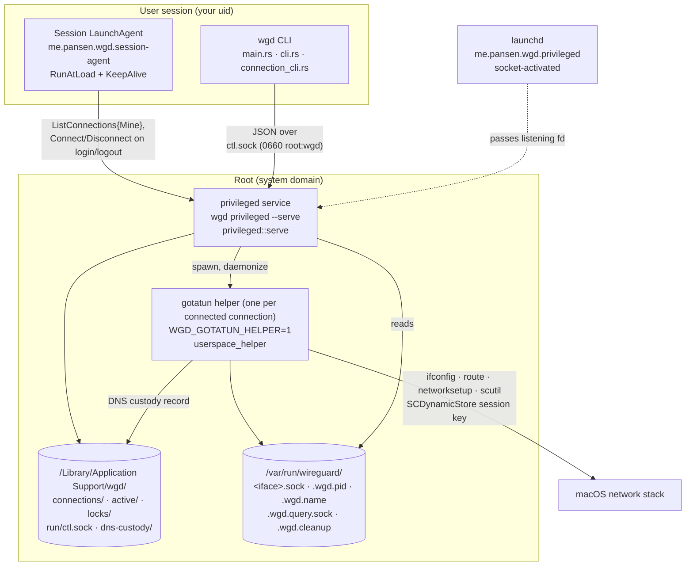
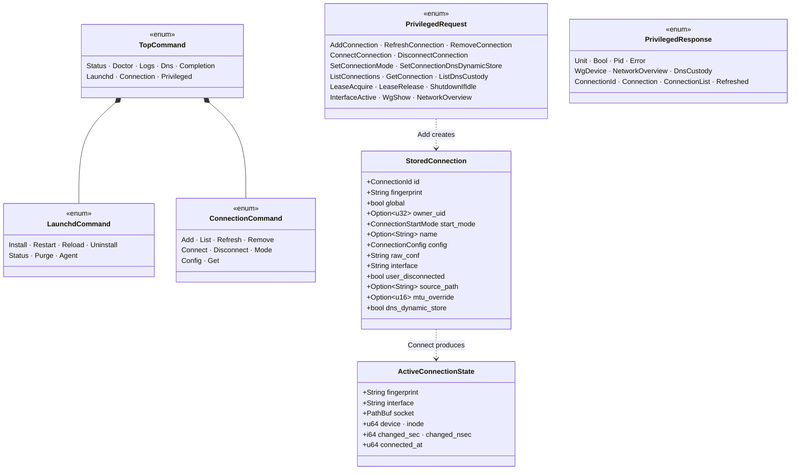
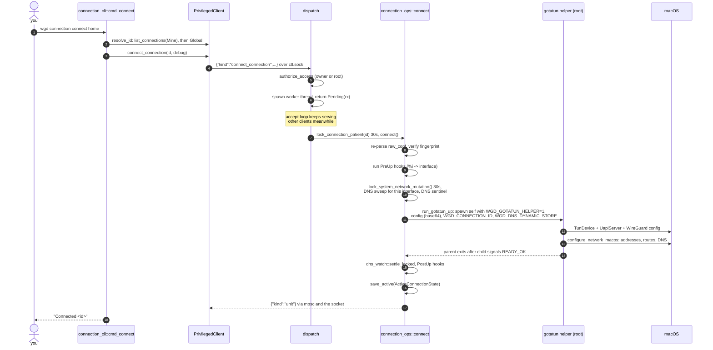
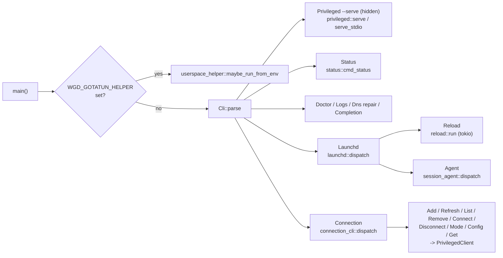
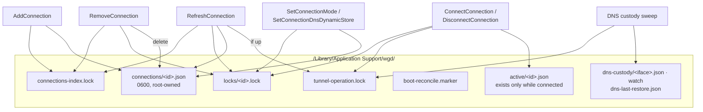
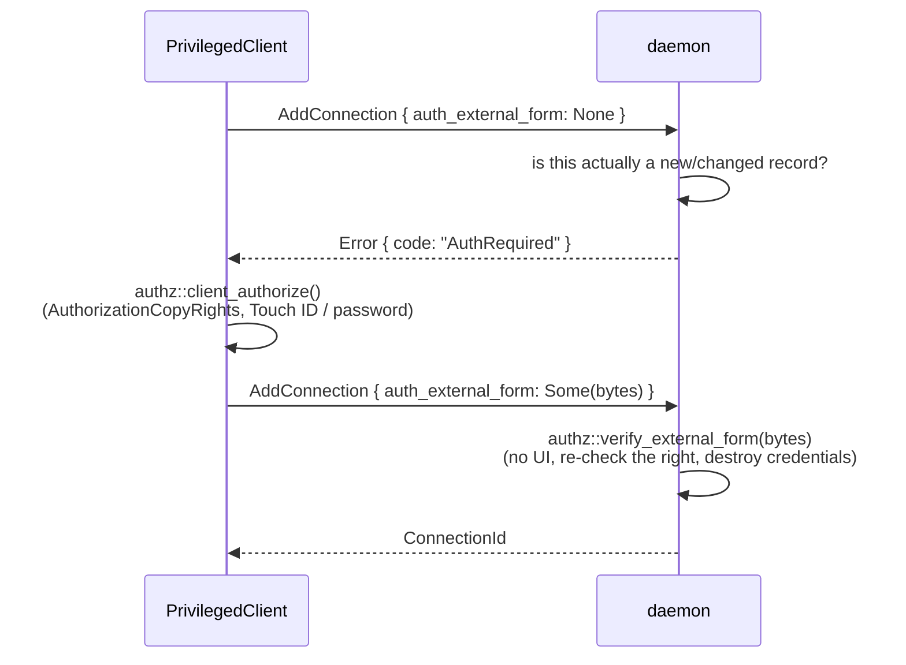
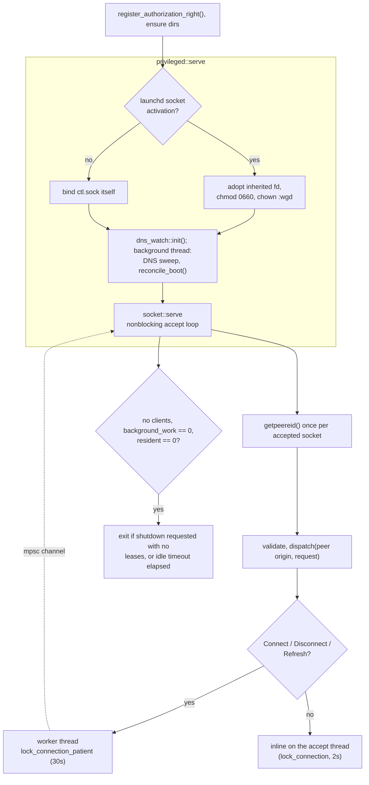
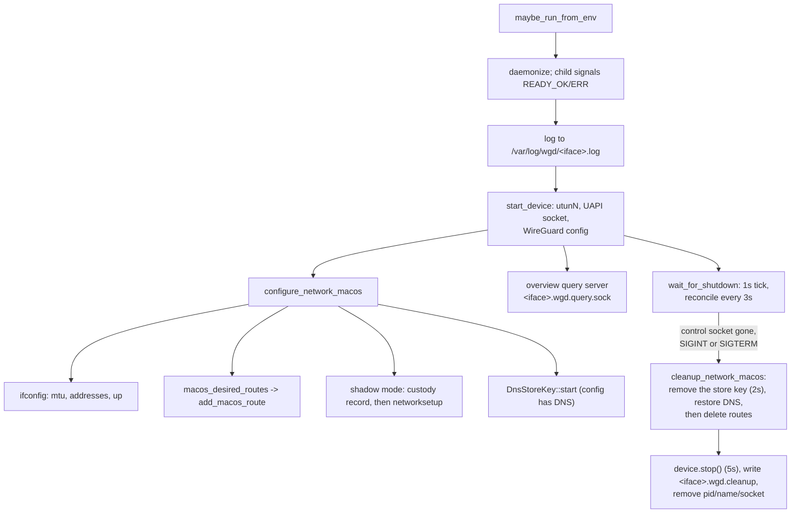
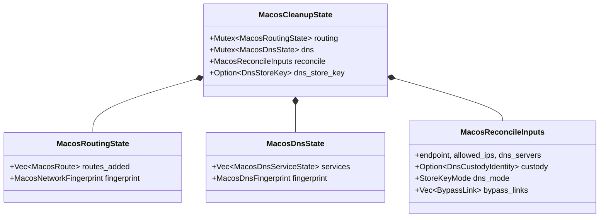
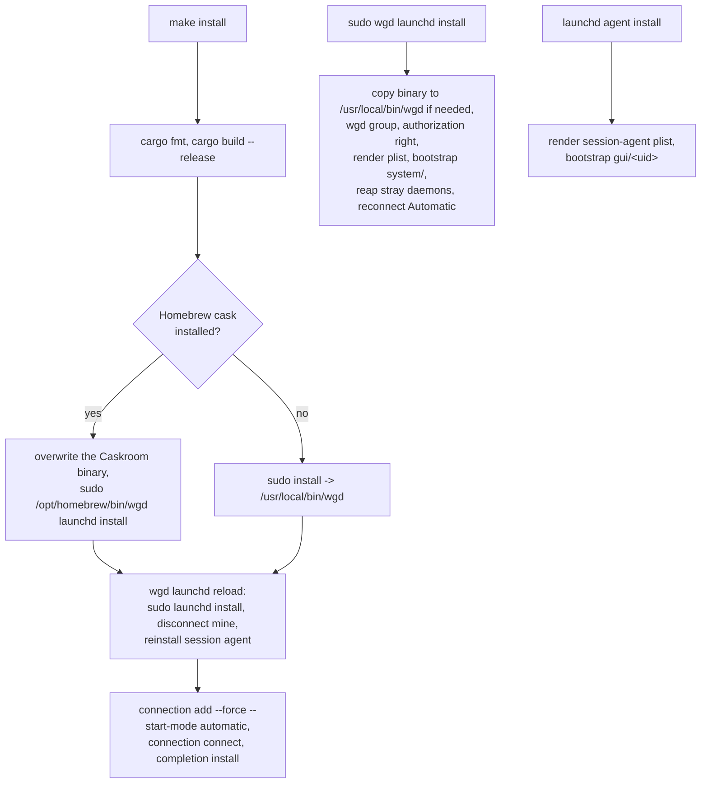

# Architecture: how the pieces fit together

**Scope:** the whole `wgd` binary, all three roles it runs in.

One binary, three roles. `main()` checks for the helper role before parsing
any arguments; everything else is decided by the CLI parser:

- **helper** if `WGD_GOTATUN_HELPER` is set (`userspace_helper::maybe_run_from_env`),
- **privileged service** for the hidden `wgd privileged --serve` subcommand,
- **user CLI** for everything else.

The user CLI never touches routes, tunnel DNS, or the WireGuard control
socket. It sends a JSON request to the privileged service over a Unix socket
(or over stdio when spawned via `sudo -n`), and the service either does the
work itself or spawns a per-connection helper that owns that tunnel for its
lifetime. Exceptions: `wgd launchd install|uninstall|purge` and `wgd dns
repair` escalate with `sudo` and run as root in the CLI process, and the
read-only `wgd status --dns` runs `networksetup` itself.

## Processes and the privilege boundary



The boundary is the socket. Everything above it runs as you and is
replaceable; everything below it runs as root and is deliberately small.
`trusted_exec` (`src/trusted_exec.rs`) maps every tool root runs (`ifconfig`,
`route`, `networksetup`, `scutil`, `sh` for hooks and a few more) to a fixed
absolute system path and sanitizes the environment. The wgd binary's install
location and the root-owned state directories are separately checked for
root ownership and no symlinks. The CLI holds no state; everything about a
connection, including its private key, lives only in the privileged store.

How launchd starts the daemon and how clients reach it is in
[launchd-socket-activation.md](launchd-socket-activation.md).

## The main types



`StoredConnection` is one JSON file per id under `connections/`: the parsed
`ConnectionConfig`, the verbatim `raw_conf`, and a SHA-256 `fingerprint` over
the parsed struct. Dedup identity is `(fingerprint, global, owner_uid)`, not
the id. `ActiveConnectionState` exists only while a connection is up; the UAPI
socket's device, inode and change time tell a running tunnel apart from a
stale marker left by a crash or reboot.

`user_disconnected` records an explicit `wgd connection disconnect` and keeps
an `Automatic` connection down until the next explicit connect or a mode
change to `Automatic`. Connect and disconnect requests carry a reason
(`ConnectReason::User|Reconciliation`, `DisconnectReason::User|SessionTeardown`)
so only the user's own actions change it. `dns_dynamic_store` selects the DNS
path (see "Tunnel DNS").

## One connect, end to end

`wgd connection connect home`, for a per-user connection `home`:



`connect()` refuses a record whose re-parsed fingerprint no longer matches
("stored connection is stale ...; remove and re-add it"), requires exactly one
`[Peer]`, clears a dead helper's leftovers on the same interface, and refuses
to adopt a socket whose device/inode/ctime does not match the active record.
A failing PostUp hook rolls the tunnel back.

Connect, Disconnect and Refresh run on a worker thread (the client waits up
to 60 s), so a slow bring-up cannot freeze other clients. Everything else runs
on the accept thread under a 2 s lock bound. Two locks are involved: the
per-id lock guards the records, and `lock_system_network_mutation()`
(`tunnel-operation.lock`, one for the whole daemon) guards
`run_gotatun_up`/`run_gotatun_down` and every DNS custody sweep, because
routes and DNS are machine-wide state.

## Command dispatch



Everything except `launchd reload` is synchronous. `reload` re-runs `launchd
install` under `sudo`, disconnects the caller's connections through
`PrivilegedClient`, and reinstalls the session agent. `resolve_id` tries the
argument as a `ConnectionId`, then as a name among `Mine`, then `Global`
(under `sudo`: all connections, preferring `SUDO_UID`'s), and errors on zero
or several matches.

## Connection store and locking



Locking rule, enforced by `IndexLock`/`ConnectionLock` being required
parameters: **index-then-per-id, never the reverse**. `AddConnection` holds
the index lock across interface-name allocation (`wg-<8 hex>`, derived from
the id) and record creation. `RemoveConnection` takes the index lock, then
the per-id lock, and refuses with `Busy` while the connection is up. The
other per-connection requests take only the per-id lock.

`RefreshConnection` takes the index lock, then the per-id lock (2 s), so the
"no other record has this fingerprint" check is atomic with writing the new
record. For a connection that is up: check duplicates, require admin
authentication, disconnect with the old record (its `PreDown`/`PostDown`
hooks live there), write the new record, release the index lock, reconnect.
The reconnect calls `connect` directly, so `user_disconnected` stays as it
was; if it fails, the error says the new record is already stored.

## Admin authentication

Adding, removing, refreshing to a changed config, and switching a global
connection from manual to automatic require real macOS admin
authentication, not just `wgd`-group membership: these are the only
operations that let new root-executed content (including hooks) into the
store or make it run unattended at boot.



`RefreshConnection` asks only when the new text fingerprints differently, and
before disconnecting anything; otherwise it just updates `source_path`, which
the daemon never opens. An identical resubmission of `add` never creates a
record; a changed `name` or `start_mode` updates in place without a prompt,
except the manual-to-automatic switch of a global connection. Connect,
disconnect, every other mode change and the DNS opt-in proceed on ownership
alone.

The right `me.pansen.wgd.modify-connection` (admin, non-shared, 60 s) is
registered at `wgd launchd install` and at every daemon start, before any
transport serves; a failed registration stops the daemon with repair
guidance. The 60 s lifetime lets one authorization survive the handoff from
CLI to daemon; the built-in `authenticate-admin` rule has a zero timeout and
caused a second prompt. A non-interactive failure (`-60007`) points to an
expired credential or an outdated rule and suggests `wgd launchd reload`.
Interactive regression check: `cargo test --lib
authenticated_external_form_verifies_once_without_reprompting -- --ignored`
(one prompt, no second one, consumed credentials rejected).

## Boot and session reconciliation

- **Global connections** reconcile at daemon start, which after a reboot is
  the first touch of `ctl.sock` (or the launchd start caused by the DNS
  sentinel). A background thread, started once the socket is bound, sweeps
  DNS left by dead helpers and then runs `reconcile_boot()`: skip if
  `boot-reconcile.marker` already holds this boot's id (`sysctl
  kern.boottime`), else connect every `global`, `Automatic`, not
  `user_disconnected`, inactive connection. The marker is written only if
  every candidate succeeded, so a transient failure is retried at the next
  wake.
- **Per-user connections** reconcile through the session agent (`wgd launchd
  agent run`, a LaunchAgent with `RunAtLoad`+`KeepAlive`). It blocks
  `SIGTERM` first, so a reinstall mid-reconcile cannot kill it without
  teardown, connects every `Automatic` connection that is neither connected
  nor `user_disconnected`, then waits in `sigwait(3)`. On logout it
  disconnects what is connected (`SessionTeardown`) and exits. It reconciles
  only once: a crashed helper stays down until the next login or an explicit
  `connect`. Fast user switching is not covered.

`wgd connection add|mode|connect|refresh` and `sudo wgd launchd install`
install a missing session agent when a per-user `Automatic` connection needs
it; `wgd status` warns when it is not loaded. Both reconcilers end in the same
`connection_ops::connect`/`disconnect` as the RPCs.

## Inside the privileged service



The uid from `getpeereid()` decides ownership: a global record requires
root, a per-user record its owner or root. The same rule gates the older
interface-keyed `WgShow`/`NetworkOverview`/`InterfaceActive` whenever the
interface belongs to a stored connection. `background_work` keeps the daemon
up during the startup sweep and boot reconcile (otherwise it could idle-exit
before `active/<id>.json` is written); `resident` is held by the DNS custody
watch. Limits: 32 clients, 1 MiB per request, 2 MiB per response, 10 s I/O
per client. The wire format is newline-delimited JSON tagged by `kind`, with
optional `{"log": ...}` frames before the response.

The `stdio` transport (`sudo -n <exe> privileged --serve --stdio`) treats its
peer as uid 0, since the caller already proved root; a best-effort
`$SUDO_UID` only picks the owner of a per-user `AddConnection`.

## Inside the helper

One helper per connected connection, spawned by `connection_ops::connect`
via `commands::run_gotatun_up`. It daemonizes and owns the tunnel until its
UAPI socket is removed or it is signalled.



Teardown is a handshake, not a kill. `run_gotatun_down` removes the UAPI
socket, waits up to 15 s for `ok` in the cleanup-status file, falls back to
`SIGTERM` and 5 more seconds, and only then checks that `utunN` is gone.
`PreDown`/`PostDown` hooks are best-effort: a broken hook logs and is
skipped.

## Continuous reconciliation

Every 3 s the helper re-snapshots the network and, if anything moved,
re-applies routes and then DNS in one `spawn_blocking` call, awaited so ticks
cannot overlap and teardown cannot race a change, and so shelling out never
stalls the single-threaded runtime that moves packets.



**Routes:** `macos_desired_routes` is the endpoint pin (only when AllowedIPs
would capture the endpoint) plus the AllowedIPs, minus anything inside a
directly connected subnet, so a split tunnel never hijacks the LAN you are
on. Because a prefix holds only one entry, two more rules are needed when
roaming into a subnet the tunnel also routes: `add_macos_route` clears a
stale entry only when a tunnel device owns it, and
`macos_restore_shadowed_lan_route` re-adds the connected route whenever
removing a tunnel route leaves a local subnet uncovered.

**Bypass links:** a per-connection `BypassLink { anchor, bypass }`
(`doc/lan-bypass-links.md`) takes more routes off the tunnel while the anchor
is attached. The daemon validates the stored links against the current
AllowedIPs at connect and hands the valid ones to the helper as JSON in
`WGD_BYPASS_LINKS`. After the connected-subnet filter, `macos_desired_routes`
also drops a route whose normalised destination equals a prefix of an active
link, where a link is active when some connected subnet contains its anchor
(`macos_route_excluded_by_link`). The decision depends only on `local_subnets`
and the static links, so the route fingerprint needs no new field, and the
initial connect and the 3 s tick behave the same. Linked prefixes never join
`local_subnets`, because `macos_restore_shadowed_lan_route` would re-add them
as connected routes.

**DNS, `networksetup` path:** `dns_decision` yields `Apply(targets)`,
`RestoreAll` (a tunnel DNS server is inside a connected LAN) or `Hold` (no
settled primary service). The I/O-free `plan_dns_actions` turns that into
services to capture, apply, restore or drop; under the `PrimaryOnly` policy
only the service owning global resolution gets tunnel DNS.
`dns_reconcile_forced` covers a DHCP resolver on the LAN that shadows the
tunnel DNS address, which no fingerprint sees. The custody record is
rewritten before any service changes.

**DNS, active dynamic store mode:** only the LAN collision is re-evaluated,
withdrawing or republishing the key; nothing on the physical services
belongs to wgd.

## Tunnel DNS

`StoredConnection::dns_dynamic_store` chooses one of two paths; design,
rollout and test results are in [dns-dynamic-store.md](dns-dynamic-store.md).

- **Shadow mode (default):** `networksetup` on the primary service, which
  writes persistent settings and therefore needs crash recovery (below). The
  helper also publishes the dynamic store key with a probe match domain
  (`wgd-shadow-<id>.inactive`) that answers no real query.
- **Active mode** (`wgd connection config --dns-dynamic-store`, passed to the
  helper as `WGD_DNS_DYNAMIC_STORE=1`): the key has the match domain `""`, a
  domain-less resolver that sorts ahead of the network's default resolver,
  and `networksetup` is never called.

The key `State:/Network/Service/<id>/DNS` uses a UUID derived from the
connection id. One owner thread per helper (`macos::dns_store_key`) holds a
session-keys `SCDynamicStore` session and does every SC call: publish after
the routes, withdraw on a LAN collision, republish when the key goes missing
(notification plus a 30 s poll), remove at teardown. configd keeps the key in
memory only and drops it with the session, so a dead helper or a reboot
leaves nothing behind. Everyone else only reads the key: a plain `set` from
another session would make it permanent.

## DNS crash recovery

Only for the `networksetup` path, where a helper killed without teardown
leaves tunnel DNS in persistent settings:

- **Custody record:** before changing a service's DNS, the helper writes
  `dns-custody/<iface>.json` (connection id, helper pid and start time, tunnel
  DNS, each service's original servers and search domains). Teardown deletes
  it, or keeps only the services that failed. The directory is root-only and
  created by the daemon.
- **Sweep** (`dns_sweep`, under `tunnel-operation.lock`): for each record whose
  helper is dead, a service still carrying the tunnel DNS gets its original
  back, a service changed meanwhile is left alone, a service missing from the
  current location is deferred; `ClearStray` handles DNS of a dead stored
  connection without a record. Sweeps run at daemon start, at connect, when a
  watched helper exits, from a 60 s retry loop after a failed restore, and
  once as root in `wgd dns repair` and `wgd launchd purge`. The last restore
  of the boot is shown by `wgd status`.
- **Exit watch** (`dns_watch`): kqueue `EVFILT_PROC`/`NOTE_EXIT` on each
  recorded helper; watches and the retry loop hold `resident`, so the daemon
  does not idle-exit.
- **Sentinel** `dns-custody/watch`: created by the daemon before spawning a
  DNS-promoting helper and by the helper after each record, removed only by
  the daemon. The plist's `KeepAlive`/`PathState` on it makes launchd start
  the daemon, also at boot, so a helper that died while the daemon was idle
  or before a reboot is still noticed.

Known gap: a running daemon misses a record a helper writes on its own after
connect ([dns-custody-late-record-watch.md](dns-custody-late-record-watch.md)).

## Status

`wgd status` (`src/status.rs`) is read-only. `collect_status` builds a typed
`StatusReport` and `render_status` renders it without I/O; `--json`,
`wgd doctor` and the menu bar reuse both. As root it lists all connections,
filtered by `SUDO_UID`.

```mermaid
sequenceDiagram
    participant S as collect_status
    participant D as privileged
    participant HP as helper

    S->>D: ListConnections(Mine), ListConnections(Global)
    loop per connected connection (global ones only as root)
        S->>D: WgShow -> WgDevice
        S->>D: NetworkOverview
        D->>HP: &lt;iface&gt;.wgd.query.sock
        HP-->>D: JSON: routes, tunnel DNS, dynamic store key,<br/>system resolver, other tunnels
        D-->>S: NetworkOverview
    end
    S->>D: ListDnsCustody (best effort)
```

Detail fetches are best-effort; a failure goes to stderr and never fails
`status`. The menu bar (`macos/WgdBar`, `menu_bar::snapshot`) fetches once
per Darwin notification `me.pansen.wgd.status-changed` (`src/status_notify.rs`),
debounced by 250 ms, with a 30 s fallback poll. The daemon posts after
connect, disconnect, add, remove and a helper exit; the helper posts when a
reconcile changed something. The ping carries no data, so a forged one only
costs a fetch, and the app holds no connection that would keep the daemon up.

## Installation and lifecycle



`reload` refuses to run as root and escalates only the daemon step. `make
install` runs it before `connection add` so the fresh session agent is not
torn down again right after the connection comes up. Neither plist sets
`ExitTimeOut`, so launchd's 5 s default applies at logout and shutdown.
`launchd uninstall` and `purge` are described in
[launchd-socket-activation.md](launchd-socket-activation.md).

## Where to start reading

| Question | File |
| --- | --- |
| What commands exist? | `src/cli.rs` |
| What happens for a connect? | `src/connection_cli.rs`, `src/privileged/connection_ops.rs` |
| What crosses the privilege boundary? | `src/privileged_api.rs`, `src/privileged_client/` |
| What does root actually run? | `src/privileged/commands.rs`, `src/trusted_exec.rs` |
| Store layout and identity? | `src/privileged/connection_store.rs` |
| Admin authentication? | `src/privileged/authz.rs` |
| Login/logout reconciliation? | `src/session_agent.rs` |
| Routes and DNS in the helper? | `src/userspace_helper/macos/` |
| Dynamic store DNS? | `src/dns_dynamic_store.rs`, `src/userspace_helper/macos/dns_store_key.rs` |
| DNS crash recovery? | `src/dns_custody.rs`, `src/privileged/dns_sweep.rs`, `src/privileged/dns_watch.rs` |
| Status? | `src/status.rs`, `src/status_model.rs`, `src/status_render.rs` |
| Install and daemon startup? | `src/launchd.rs`, `src/reload.rs` |
